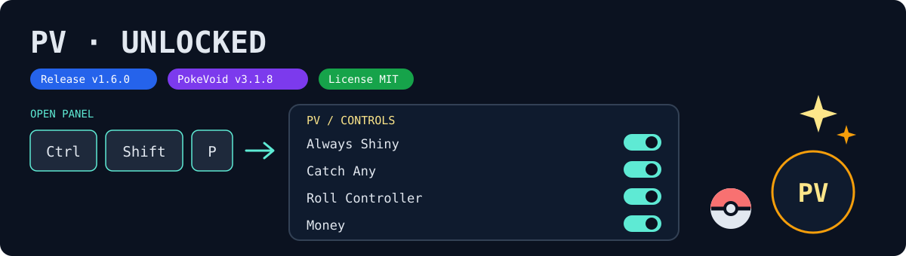
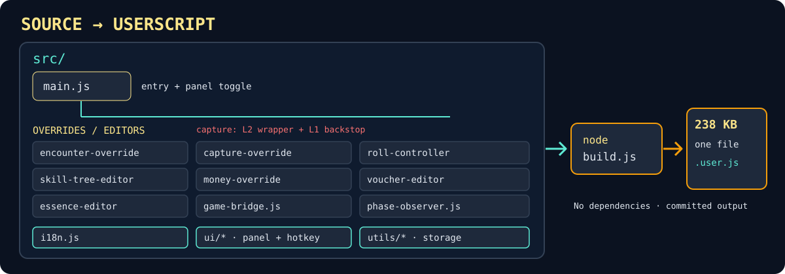

# PokeVoid-Unlocked

[](https://github.com/GangstaVik/PokeVoid-Unlocked/releases/tag/v1.6.0)
[](https://www.pokevoid.com)
[](LICENSE)



A free, open-source userscript that adds native-safe unlock features to the **browser version** of PokeVoid in one 238 KB file.

## What it is

PokeVoid-Unlocked is a dependency-free, bundled userscript for Tampermonkey or Violentmonkey. It adds controls to the browser game without installing a game mod: download the single file, then open the in-game panel with a hotkey or the PV floating button.

## Features

| Feature | Description |
| --- | --- |
| Always Shiny | Force shiny encounters. Bosses, rivals and legendaries are deliberately bypassed. |
| Catch Any | When the capture toggle is active, any Pokéball that the game's native catch gate would reject for a single, non-excluded target is force-injected, and that catch is guaranteed. Throws the game accepts on its own keep native catch odds. |
| Roll Controller | 3 honest toggles operating on real roll values (no cosmetic probabilities), with real itemcount scaling. |
| Skill Tree Editor | Edit skill points for the current run. Event-driven refresh since v1.2.0. |
| Money Override | Set the in-game currency value. BigInt-safe. |
| Voucher Editor | Grant vouchers directly. Available since v1.2.0. |
| Battle tab | Shiny/capture toggles from the battle screen; settings persist between sessions. Available since v1.3.0. |

> UI and utility modules that back these features are listed in [How it works](#how-it-works).

## Proof of regression discipline

- **v1.5.1 — capture:** An `Array.isArray` guard introduced in `fa53abd` had silently disabled force-inject in **all** battles, not just rival battles: the real game bundle produces object-shaped `turnCommands`. The gate now accepts those commands, restoring forced catches in every battle path.
- **v1.5.1 — essences:** The hardcoded 21-key id=index fallback was replaced with the canonical 24-entry `TYPE_IDS` map (`UNKNOWN: -1` plus all 23 native ids from enum S in bundle v3.1.8). `SMITTY`, `GLITCH` and `GEN_ONE` now use the correct native type regardless of list order. See [CHANGELOG.md](CHANGELOG.md).

## How to use

1. Install a userscript manager (**Tampermonkey** or **Violentmonkey**).
2. Download [`pokevoid-unlocked.user.js`](pokevoid-unlocked.user.js) from this repository (raw URL) or copy-paste its content into a new userscript.
3. Confirm the installation in the userscript manager.
4. Open pokevoid.com — press **`Ctrl+Shift+P`** (default hotkey, rebindable from the About modal, see `src/ui/hotkey.js`) or click the **PV floating button** in the bottom-right corner to open or close the panel.

## How it works

The single 238 KB (238,259-byte) dependency-free userscript is built from `src/` with Node.js 22 LTS (build step only):

```bash
node build.js
```

`pokevoid-unlocked.user.js` is generated from `src/` and committed intentionally. A rebuild should leave a zero-diff output file. There is no `package.json` or build dependency; players install the already-built file and do not need to run the build.



### Structure

```
src/
├── main.js                    — entry point, panel toggle (Ctrl+Shift+P)
├── i18n.js                    — UI dictionary (t())
├── encounter-override.js      — Always Shiny
├── capture-override.js        — Catch Any guaranteed catch for gate-rejected throws (L2 command wrapper + L1 backstop)
├── roll-controller.js         — Roll Controller (3 toggles + itemcount)
├── skill-tree-editor.js       — Skill Tree Editor
├── money-override.js          — Money Override (BigInt-safe)
├── voucher-editor.js          — Voucher Editor
├── essence-editor.js          — Type essence editor (runtime API discovery)
├── game-bridge.js             — game API bridge
├── phase-observer.js          — battle phase hooks
├── ui/
│   ├── floating-btn.js        — PV-monogram floating action button
│   ├── hotkey.js              — toggle hotkey (rebindable)
│   ├── panel.js               — panel shell
│   ├── battle-screen.js       — battle tab toggles
│   ├── roll-screen.js         — roll controls UI
│   ├── skill-screen.js        — skill editor UI
│   ├── voucher-screen.js      — voucher editor UI
│   ├── essence-screen.js      — type essence editor UI
│   └── styles.js              — UI styling
├── utils/
│   ├── config.js              — configuration
│   ├── helpers.js             — shared helpers
│   └── storage.js             — settings persistence
build.js                        — build script (no dependencies)
```

Key entry points and modules by path: `src/ui/floating-btn.js`, `src/game-bridge.js`, `src/phase-observer.js`, `src/utils/storage.js` (full structure above).

## Boundaries

- **Browser build only.** Downloadable PokeVoid builds are not supported. The target is game build v3.1.8 (bundle `index-BA2n6IsS.js`, ~25.7 MB); a new game bundle may stop the hooks matching until updated. Chrome, Firefox and Edge latest are supported; Chromium is recommended. See [compatibility details](docs/COMPATIBILITY.md).
- **Honest limits:** Always Shiny deliberately bypasses bosses, rivals and legendaries. Catch Any guarantees a catch only for a single gate-rejected, non-excluded target; throws the game accepts on its own keep native catch odds. Roll Controller operates on real roll values with real itemcount scaling, never cosmetic probabilities.
- This is a personal browser userscript, not an official PokeVoid feature or a mod for downloadable builds. Players need no build step; Node.js 22 LTS is only for contributors building from source.

## Trust

This project is based on **[JsPoRoMod](https://github.com/PokeRogueMOD/JsPoRoMod)**. Its source and intentionally committed generated userscript are available under the MIT license, © 2026 GangstaVik. Compatibility is tied to the browser bundle noted above; the specific capture and essence fixes are documented in [CHANGELOG.md](CHANGELOG.md).

## Documentation

- [Compatibility and tested builds](docs/COMPATIBILITY.md)
- [Contributing and build verification](docs/CONTRIBUTING.md)
- [Design notes](docs/design.md)
- [Changelog](CHANGELOG.md)
- [Superpowers documentation](docs/superpowers/)

## License

[MIT](LICENSE) © 2026 GangstaVik

---
Maintained by GangstaVik · © 2026 · Personal project — unaffiliated with and not endorsed by the copyright holders of PokeVoid. Based on [JsPoRoMod](https://github.com/PokeRogueMOD/JsPoRoMod).
